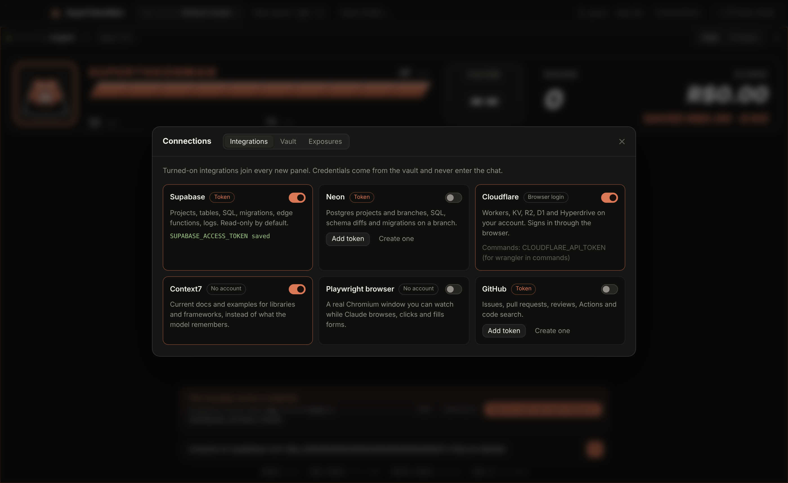

# SuperTokenMan app

A desktop app around Claude Code: a streaming chat, tool approvals in the window, and the SuperTokenMan HUD (context as HP, plan windows as stamina, the prompt cache as the round timer, the session value in BRL as the score). It runs Claude Code through the Agent SDK with your own login, settings, plugins and hooks (token-kit included).



## Run

```
cd app
npm install
npm start                # builds, then opens the window in the current folder
npm run dev              # Vite with hot reload + Electron
```

Open another folder with the folder button at the top.

## Install as a Mac app

```bash
cd app && npm run install:mac
```

Pulls, builds `SuperTokenMan.app` for this Mac's chip, puts it in `/Applications` and opens it. Run the
same command to update; the installed app also checks its checkout every 6 hours and offers the update
in the bell.

- This local install is signed ad hoc for your own Mac (the script clears the quarantine flag). Builds for
  other people are signed with a Developer ID and notarized: see `docs/RELEASE.md`.
- Camera, microphone (calls in the Apps drawer) and Apple Events (Spotify) are asked the first time.
- Opened from the Finder, the app reads your login shell's PATH, so git, gh, docker and npx resolve as
  in the terminal, and the first panel starts in the last folder you used.
- `npm run dist:mac` (Apple Silicon) or `npm run dist:mac-intel` only build, into `release/`.

## Layout

- `electron/session.ts`: one Claude Code session (a long-lived `query` fed by a prompt queue), its messages turned into UI events, tool permissions asked of the window. Tested with a fake SDK.
- `electron/main.ts`, `electron/preload.cjs`: the window and the IPC bridge.
- `src/state.ts`: a pure reducer from events to the window's state, and the HUD view.
- `src/App.tsx`: the chat, the permission cards, the composer. The HUD is `hudBand` from `../token-kit/mod/supertokenman/hooks/hud.ts`, the same drawing as the mod.

## Checks

```
npm run typecheck && npm test && npm run build
```

Panels: Cmd+T opens a panel in the focused panel's folder, Cmd+W closes it; each panel is its own session with its own folder, model and HUD, and the top bar sums their cost.

Diffs: every Edit, MultiEdit and Write shows as a line diff on its permission card and in the panel's Changes tab (a Write is compared with the file on disk before it runs).

Private mode (the Private button or Cmd+Shift+P) asks the system to leave the window out of screen sharing and recordings (Electron setContentProtection). It is remembered across launches. Check it with the tool you share with before relying on it.

Coach: local rules (no model calls) suggest compacting a full context, warn before and after the prompt cache goes cold, point a top model that only reads to a cheaper one, and flag a plan window past 80%. Tips are dismissable; Compact sends /compact.

Replies render as Markdown (a small renderer of our own, React elements only, never HTML strings). Panels narrower than 720 px switch to a one-line HUD.

Panels talk to each other: every session gets list_panels (runs without asking) and message_panel (always asks). A message runs as a turn in the target panel, shown there as "From <panel>", and its reply comes back as the tool result. A message that would close a wait cycle is refused, and one with no answer in 15 minutes times out.

Commands: Cmd+Enter runs the composer text in the panel's folder with your login shell, no model involved; "Send to Claude" hands it the command and output.

Connections: integrations (Supabase, Neon, Cloudflare, Cloudflare docs, GitHub, Context7, Playwright, Stripe, Sentry, Vercel) join new panels with credentials from the vault. The vault encrypts with the system keychain (Electron safeStorage); the window only ever sees names. A prompt carrying a credential is stopped before it is sent, with an option to save it to the vault and send the message without it; credentials in anything shown are masked and listed under Exposures.

Catalog (Cmd+K): one live search over the plugins of your marketplaces (installed or not), your skills, the official MCP registry and GitHub. Install or remove plugins, add an MCP server as an integration, or add a repository as a marketplace.

Memory (Cmd+J) opens on a map of the vault: the current project at the center, rules above, its sessions on a spiral from newest (near) to oldest (far) sized by what they cost, other projects with their sessions on an outer ring, and links for sessions that changed the same files and for [[wiki links]]. Hover lights a note's links, click reads it beside the map. List view keeps earlier Claude Code sessions of the folder to resume where they stopped (SDK resume), the token-kit vault's session notes to search and reuse as context, and a Remember button on each panel that appends the last reply to the project's note.

token-kit, live: the app follows the kit's stats file; each cut in a panel's session raises its SAVED and KO count and plays the K.O. screen. Idle panels sleep after 15 minutes (their Claude Code process ends) and resume on the next message.

Focus: rounds of 25, 50 or 90 minutes with a goal and a panel; the clock sits in the top bar, the other panels dim and the coach keeps to what is urgent; a round ends with its turns and cost and offers a 5-minute break. Time is counted per minute and per project (yours while you are active, Claude's while a panel works) and summed for today and 7 days; after 90 minutes without a pause the coach suggests one.

Moods: the hero in the HUD shows how the session is going: joy on a K.O., anger when a credential shows up or something fails, fear near a full context or plan window, disgust at a huge command output, sadness when the cache goes cold, plus focus, working, asleep and ready. Each has its own color, face and animation (docs-moods.gif).

Themes (Cmd+,): Claude Dark, Claude Paper, Arcade Neon, Game Boy, Midnight Ink and Sunset Synth, or System to follow macOS. One palette drives every CSS variable and recolors the HUD and the vault map; the hero keeps his own colors in every theme.

Music (macOS): what Spotify plays sits in the top bar; the player has a seekable progress bar, controls, volume and the playlists you saved by link (title and cover from Spotify's public oEmbed). It drives the Spotify app through AppleScript: no API key, no Premium.

CI: each panel follows the GitHub Actions runs of its branch (the vault's GitHub token or the gh login), every 20 s while one runs. The CI tab shows runs, jobs and steps; a failed job shows the log lines that explain it, with Re-run failed and Ask Claude to fix. The hero cheers a green run and fumes at a red one.

WhatsApp (Cmd+Shift+W): WhatsApp Web in a resizable drawer, logged in once (its own storage), kept running while closed, with the unread count on its button. The main process lets that view load only WhatsApp's own pages, with no preload and no Node; chat links open in the browser. Claude does not read or send messages.

Git: a Git tab per panel: branch switcher, ahead and behind, pull and push (or publish a new branch), staged and unstaged files with their diffs, a commit box with a message suggested by Haiku from the staged diff, and the history drawn with its lanes and refs.

Not yet: enemies, sessions talking to each other, integrations, session resume.
