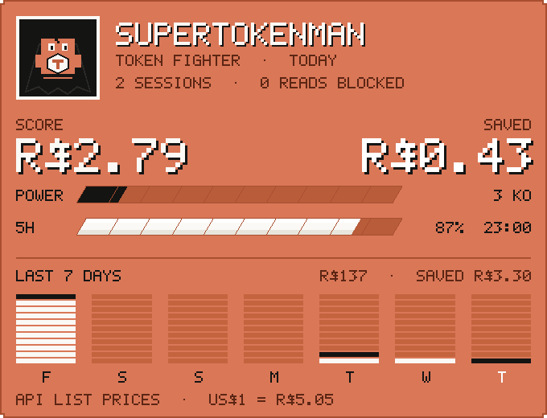

# token-kit

Token savings for Claude Code without lowering answer quality. The kit keeps noise out of the context (logs, huge listings, files read whole for no reason), warns you when continuing a conversation got expensive, and shows, from your own transcripts, where your usage goes.

The rule is **never lose information**. Every condensed output has the full output saved to a file, with the path printed at the end, and Claude can grep or sed it when needed. Error lines, test failures and summaries are never cut.

## What is in it

| Piece | When it runs | What it does |
| - | - | - |
| `pre-bash` (PreToolUse) | before every Bash command | 1) passes the command through [RTK](https://github.com/rtk-ai/rtk) when it is installed (git, ls, grep...); 2) wraps tests, build/typecheck, installs, wrangler deploys, docker builds and ffmpeg with the condenser. Also works when the command **fails**, which is when output is largest |
| `post-bash` (PostToolUse) | after a successful command | safety net: output over 10k characters that nothing wrapped becomes head + tail + errors |
| `read-guard` (PreToolUse) | before a `Read` without offset/limit | blocks the first full read of a large file (over 600 lines or 60 KB, or a lockfile) and suggests Grep + a section. **The second attempt goes through** |
| `prompt-nudge` (UserPromptSubmit) | when you send a message | warns **you**, without spending model tokens, when context passes 60% and 85%, when the cache expired and the message will reprocess everything, or when the 5h window passes 80% |
| statusline | always (terminal) | `Opus low · ctx 34% 68k · 5h 23% resets 14:30 · 7d 41% · cache 42min · kit -12k today` |
| `tk analyze` | on demand | reads `~/.claude/projects/**/*.jsonl` and attributes cost, in your currency, to fixed context, each command and file, lost cache, thinking and subagents |
| `tk audit` | on demand | shows what is loaded on every message (CLAUDE.md, plugins, MCP, skills) |
| `session-note` (Stop, background) | after every reply | writes this session's note into the memory vault, from the transcript, at no token cost |
| CLAUDE.md rules | optional (`--claude-md`) | 5 lines that teach Claude to locate before reading and to use the full-output log, plus where the vault is |

### Measured in Claude Code 2.1.308 (a real session, not only tests)

- `npm test` with 1 failure out of 211 tests: **222 lines became 11**, keeping the file, assertion, expected/received, error line, summary and exit code 1. The model identified the right test.
- `seq 1 5000` (successful output): about 24k characters became **353**, with head, tail and the full-output path. The model answered the last line correctly.
- Hooks load both from `--settings` and from the user-level `~/.claude/settings.json`.

## Why it saves more than it seems

Every message resends the whole conversation. A 10k-token `npm test` at the start of a session is re-read on **every** following message until you `/clear` or `/compact`. `tk analyze` does that math: an item costs its cache write plus every re-read. The session where this kit was built came to **R$102 (US$20) at API prices** over 188 requests, with context peaking at 565k tokens; Claude's own responses kept in context were the largest share (22%), and 62k tokens of fixed context (plugins, skill list, MCP instructions) were re-read on every message.

## Where it works

| Where you use Claude Code | Works? | How to install |
| - | - | - |
| Terminal | yes | `./install.sh` |
| Desktop, Code tab, **local** session | should work: same `~/.claude` (not tested in the app) | `./install.sh` |
| Desktop, web or mobile, **cloud** session | yes, through the environment's setup script | see below |
| Regular Claude chat (outside Code) | **no**: there are no hooks | habits and `tk analyze` only |

The statusline belongs to the terminal UI and may not show in the app. `prompt-nudge` warnings use `systemMessage`; how the app displays them has not been checked.

## Install

Requires Node 18+.

```bash
cd token-kit
./install.sh --claude-md            # installs into ~/.claude/token-kit and edits ~/.claude/settings.json (with a backup)
node ~/.claude/token-kit/bin/tk.mjs doctor
```

`install` options:

- `--claude-md`: adds the token-saving rules to `~/.claude/CLAUDE.md`.
- `--config preset.json`: merges a preset into the kit config.
- `--effort low`: low default effort; use `/effort high` when a task needs it.
- `--subagent-model sonnet`: subagents on a cheaper model.
- `--bash-max-chars 20000`: Claude Code's cap on Bash output (default 30000).
- `--no-statusline`, `--force-statusline`.
- `--replace-rtk-hook`: if you already ran `rtk init -g`, removes RTK's hook, because the kit calls RTK itself (two hooks rewriting the same command conflict).
- `--dry-run`: prints the resulting settings without writing them.

RTK (optional, recommended): `brew install rtk` or the project's install script. The kit works without it.

### Cloud sessions (Desktop, claude.ai/code, mobile)

The cloud container is recreated for every session, so the kit comes in through the **environment's setup script**. It runs before Claude Code starts, and the result is cached with the environment.

1. Generate the script (the kit is embedded in it, so it needs neither network nor access to this private repository):
   ```bash
   node bin/tk.mjs cloud-script --claude-md --effort low --subagent-model sonnet --config presets/bzcorrida.json > dist/cloud-setup.sh
   ```
   The generated [`dist/cloud-setup.sh`](dist/cloud-setup.sh) uses these options plus `--vault /home/user/vault`, where the `arimayuji/vault` repository is cloned when it is attached to a session.
2. In the app: cloud environment menu in the session title, **Edit**, **Setup script**, paste the file's contents.
3. Start a new session. The script never fails: if something goes wrong, the session starts without the kit.

`--no-rtk` skips RTK. Low effort is only the default: raise it with `/effort` (or the app's picker) when a task needs it.

## macOS menu bar

Shows today's savings in the menu bar and, in the menu, real usage vs saved for today and the last 7 days, in your currency (BRL by default). It also shows the plan capacity the savings free up and, when a terminal session recorded it through the statusline, plan usage.

```bash
brew install --cask swiftbar                 # open the app and pick a plugin folder
brew install --cask font-poppins font-lora   # brand fonts (without them the system font is used)
tk install-bar                               # or: tk install-bar --dir <plugin folder>
```



*Simulation rendered from the plugin's real output, with sample numbers. On macOS the background and shape are those of the native menu.*

The menu opens on the SuperTokenMan card, a fighting-game HUD in pixel art: today's real usage as the score, savings and the KO count (cuts), a power bar for today's save rate, stamina bars for the 5-hour and 7-day plan windows when a terminal session has reported them, and the last 7 days as an arcade equalizer (cream usage, ink saved, today in white), all on Claude orange. The actions (analysis, diagnostics, refresh) are buttons drawn in the same style, each still a menu item that runs its command, and SwiftBar's own items are hidden. Everything is PNG drawn at 2x with a built-in 5x7 font and shown at its point size, so it needs no installed fonts and stays sharp on Retina screens. No emoji.

Numbers come from local transcripts (`~/.claude/projects`) and the kit's stats, so they cover **local sessions**. Cloud sessions stay in their container and never reach the Mac.

How the money is computed:

- **Real usage**: every request priced at its model's API list price (`lib/pricing.mjs`: input, output, 5 min and 1 h cache writes, cache reads; fast mode at 2x), converted with the day's exchange rate (frankfurter.dev, falling back to open.er-api.com, cached 12 h). On a subscription this is the API value of the work, not your bill.
- **Saved**: tokens kept out of context (chars/4) times the cache write they avoided **plus** every later re-read in the same session, at that session's model price.
- **Plan capacity freed**: the share of usage saved over 7 days times your plan's monthly price (`money.planMonthlyUsd`, default US$100 for Max 5x). It reads as "the same work now fits in that much less plan".

Set `money.currency` (any ISO code), `money.planMonthlyUsd` and `money.fallbackRate` in the config.

## Memory vault

An Obsidian vault (plain Markdown, synced with git) in three tiers, so a new session can pick up where the last one stopped without re-reading the codebase, and you can `/clear` without losing the thread.

| Tier | Where | Written by | Read |
| - | - | - | - |
| Short | `sessions/<project>/<date>-<id>.md` | the `session-note` hook, after every reply, from the transcript (no model call, no tokens) | when resuming or searching |
| Medium | `projects/<project>.md` | you and Claude, on purpose: state, decisions, next steps | at the start of work on the project |
| Long | `rules/*.md` | you | when relevant |

Nothing is loaded into context automatically. The CLAUDE.md rules tell Claude where the vault is; it reads one note or runs `tk recall <words>`, which prints only matching lines (rules and project notes first, then the newest sessions).

```bash
tk vault init ~/vault --projects bzcorrida,CLI   # skeleton; never overwrites
tk install --claude-md                           # adds the vault line to CLAUDE.md
tk recall r2 domain --project bzcorrida
```

Sync: locally, open the folder in Obsidian and use the Obsidian Git plugin. In cloud sessions, attach the vault repository to the session and pass `--vault <path where it is cloned>` to `tk cloud-script`; notes are written there, and the CLAUDE.md rule tells Claude to commit vault changes and push them straight to the vault's `main` (no branch, no pull request).

## SuperTokenMan (Claude Code mod)

[`mod/supertokenman`](mod/supertokenman) keeps the token economy on screen from the moment a session starts:

- a **widget above the prompt** (terminal and Desktop Code tab), always visible: context, 5h and 7d plan windows, minutes left on the prompt cache, the session's value at API prices and token-kit's savings in your currency;
- a **details pane** (its Details button or `/supertokenman`): bars, a cold-cache warning and the tool results that cost most because every later request re-reads them.

Install it from the `supertokenman.plugin` file (Save plugin on its card in the app). To run it from this folder instead: `claude --plugin-dir token-kit/mod/supertokenman`, or add the folder's absolute path to `CLAUDE_CODE_PLUGIN_DIRS` in the `env` block of `~/.claude/settings.json` so local Desktop sessions load it. Test it with `claude plugin test token-kit/mod/supertokenman`.

## Commands

```text
tk install | uninstall [--purge] | doctor
tk analyze [--days 30] [--path dir|file.jsonl] [--top 15] [--json]
tk stats [--days 7]           how much the kit kept out of context
tk audit [--dir .]            what is loaded on every message
tk usage [daily|session|...]  ccusage (cost from local logs)
tk condense --profile test < output.txt
tk vault init <folder> [--projects a,b] | tk recall <words> [--project name]
tk bar [--json] | tk install-bar [--dir folder]
tk cloud-script [...] > setup.sh
```

Use it together with Claude Code's own commands: `/context` (what fills the window), `/usage` (plan usage and what contributes most), `/doctor` (finds unused plugins, MCP servers and skills), `/skill-doctor`, `/compact <focus>`, `/clear`, `/effort`.

## Guarantees and escape hatches

- Small output (up to 60 lines and 6k characters) passes through **untouched**.
- Nothing is condensed unless the full output was saved to disk.
- `git diff`, `git show`, `cat`, `head`, `sed`, `jq` etc. are never condensed, and diff/show never go through RTK.
- `# tk:raw` at the end of a command turns the kit off for that command. `TOKEN_KIT_DISABLE=1` turns everything off.
- Background commands and commands with pipes, redirections or heredocs are not rewritten.
- `cd` keeps working: only the noisy segment becomes a pipeline (`cd engine && npm test 2>&1 | condense`), and the exit code is preserved with `set -o pipefail`.
- Permissions: your rules still apply to the original command. Install only adds `Bash(set -o pipefail)` and the condenser's rule, which only reads stdin and writes a log.

## Configuration

`~/.claude/token-kit/config.json` (created at install with the defaults). `tk install --config preset.json` merges a preset into it; profiles with the same name are replaced. The [`presets/bzcorrida.json`](presets/bzcorrida.json) preset covers the studio scripts (`bz/gerar.py`, `validate.py`, `t_compose_assets.py`, `render.py`...): it keeps `ERRO`, `FALHA`, tracebacks, summaries and generated files. Its patterns include Portuguese words because that is what those scripts print. They already print little, so the gain shows up mostly when something breaks.

A profile of your own:

```json
{
  "profiles": [
    {
      "name": "my-render",
      "match": "^python3?\\s+scripts/render\\.py",
      "keep": ["FAIL|Error|Traceback|saved to|\\.mp4|\\.png"],
      "drop": ["^frame=", "^\\s*\\d+%\\|"],
      "tail": 10
    }
  ],
  "rtk": { "mode": "auto" },
  "readGuard": { "maxLines": 600 }
}
```

A profile's `drop` beats its `keep`; error lines are never dropped.

## Limitations

- A **failing** command is only condensed if it was wrapped before it ran: Claude Code does not allow replacing the output of failures afterwards (`PostToolUseFailure` can only add context). Profiles cover tests, builds, installs and deploys; add a profile for other commands.
- If a command hits the timeout, Claude Code kills the shell and the condensed output never arrives; the full output stays in the log.
- RTK also summarizes `ls`, `grep` etc. If that ever gets in the way, set `"rtk": { "mode": "off" }`.
- Money figures use API list prices (cached 2026-10-06; update `lib/pricing.mjs` when prices change). Anthropic does not publish how plan limits weigh each token type, so they show the value of the work, not how much of your plan it used.
- Each hook costs one `node` start per call (tens of ms).
- Installs from earlier versions wrote the CLAUDE.md block with Portuguese markers; install and uninstall recognize both.

## Development

```bash
npm install && npm run typecheck && npm test   # 57 tests, including real bash and install/doctor/uninstall
```
